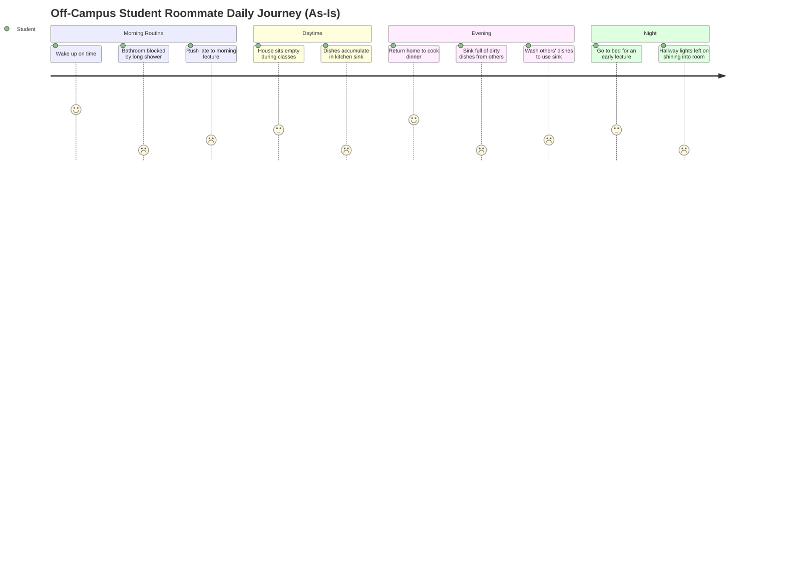

# Requirements: HouseFlow

## Problem statement
Undergraduate students living off-campus in shared rental houses experience persistent daily friction around basic household habits because everyone's schedule is desynchronized and no formal coordination exists. On a daily basis, dirty dishes pile up in the kitchen sink because housemates leave them unattended for too long, morning routines are disrupted when long showers bottleneck the shared bathroom, and hallway lights left on at night disturb sleep (Interview 1). Furthermore, because students are away on campus during the day and have little daytime cleaning availability, maintenance either gets pushed to weekends or falls onto whichever frustrated roommate finally steps in to wash everyone's dishes (Interview 1, Practice Interview). This costs housemates wasted morning time, lost sleep, and mounting interpersonal tension, turning their shared home into a daily source of stress.

## Job to be done
When I'm living in an off-campus house with roommates while managing a busy class schedule, I want to establish clear visibility and mutual accountability around shared chores, bathroom timing, and household night habits, so I can live in a clean, quiet home without daily friction or nagging my roommates.

## Users and stakeholders
| Role | Who (initials or title) | What they need from the system |
|---|---|---|
| Primary user | Off-campus student housemate (e.g., student tenant) | Quick, frictionless tracking of chores, dish status, and shared space routines without personal confrontation. |
| Stakeholder (pays, approves, or is affected) | Fellow roommates / co-tenants | Fair distribution of household responsibilities, smooth morning routines, and respect for shared quiet and lighting. |
| Stakeholder (pays, approves, or is affected) | Property Landlord / Owner | Preservation of property condition, plumbing care (no clogged sinks/drains), and stable tenant retention. |

**Not for:** Single-family homeowners, solo apartment renters, or commercial property managers looking for leasing and rent-collection platforms. This system is deliberately not designed for lease administration or financial transactions; it focuses strictly on peer-to-peer household routine and chore coordination among off-campus student roommates.

## Persona
**Alex**, a junior living off-campus in a 4-bedroom rental with three college peers. Alex juggles a full course load, leaving the house early in the morning and returning late in the afternoon. Alex's goal is to maintain a predictable, clean living space where morning routines are smooth and cooking in the kitchen doesn't require washing someone else's dishes first. Alex is frustrated by dirty dishes sitting in the sink for days, unexpected morning shower delays that cause tardiness to 8:00 AM lectures, and hallway lights left burning outside the bedroom door at night (Interview 1). Today, Alex relies on passive-aggressive group text messages, sticky notes, and occasionally stepping in to wash other people's dishes just to get by.

## Current process (as-is)
1. **Morning Routine Bottleneck:** A housemate wakes up for class, only to find the bathroom occupied by someone taking a lengthy shower with no advance warning, causing a delay in the morning flow (Interview 1).
2. **Kitchen Usage & Dish Accumulation:** A roommate cooks breakfast or lunch, rushes off to class, and leaves dirty pans and plates in the sink assuming someone else will deal with it (Interview 1).
3. **Daytime Dormancy:** Because everyone is gone during the day for classes, dirty dishes sit in the sink for hours or days, rendering the sink unusable for others who want to cook (Interview 1, Practice Interview).
4. **Ad-hoc Workarounds / Friction:** A frustrated roommate either complains in an ignored group chat or reluctantly "takes initiative" to wash the entire pile just to regain sink access (Interview 1, Practice Interview).
5. **Nighttime Disturbance:** Someone goes to sleep while common area/hallway lights remain left on, illuminating bedrooms and disrupting sleep (Interview 1).
6. **Weekend Scramble:** Roommates attempt an uncoordinated catch-up clean on Sunday to deal with the week's neglected tasks (Practice Interview).

## Journey map

## Functional requirements
| ID | The system shall... | Priority (Must / Should / Could / Won't) | Source |
|---|---|---|---|
| FR-1 | Allow housemates to log and track dirty dishes in the sink, including how long they have been there and who left them | Must | Interview 1 |
| FR-2 | Provide a quick status switcher for chores (Open, In Progress, Completed) with visual indicators | Must | Interview 1, Practice Interview |
| FR-3 | Provide a morning bathroom status indicator ("in use" / "open") or queue to prevent bathroom flow bottlenecks | Must | Interview 1 |
| FR-4 | Maintain a simple house rules checklist (e.g., hallway lights off by 11 PM, dishes cleared within 2 hours) | Must | Interview 1 |
| FR-5 | Automatically rotate weekly cleaning responsibilities (e.g., bathrooms, floor vacuuming, trash) | Should | Practice Interview |
| FR-6 | Support a designated deep cleaning schedule reminder (e.g., Sunday household clean) | Should | Practice Interview |
| FR-7 | Send opt-in reminders / gentle notifications when items (dishes, lights) remain unresolved past house agreement thresholds | Could | Interview 1 |
| FR-8 | Process financial split payments or rent/utility collections directly in the app | Won't | Discovery Scope (Handled by Splitwise/Venmo) |

## Non-functional requirements
| ID | Category (usability, security, performance, privacy, cost) | Requirement | Source |
|---|---|---|---|
| NFR-1 | Privacy | Never expose real personal names, emails, student IDs, or sensitive student records publicly. | CLAUDE.md / Course Policy |
| NFR-2 | Usability | Core actions (marking dishes done, claiming bathroom queue) must be actionable in under 3 taps on mobile. | Interview 1 (Housemates on the run) |
| NFR-3 | Performance | Page load and task state updates must sync in under 1 second using real-time database updates. | Tech Stack (Supabase) |
| NFR-4 | Security | Access restricted to verified members of a household via invite code or authenticated household link. | Tech Stack (Supabase Auth) |
| NFR-5 | Cost | Zero hosting cost for the student household (runs entirely on free tiers of Vercel and Supabase). | Project Constraints |

## Riskiest assumption
**The belief:** Housemates will actually take 5 seconds to log their dishes, check off chores, or update bathroom status rather than continuing to ignore the problem and leaving it for someone else. If roommates refuse to open the app or log their actions, the system provides zero value.  
**How we will test it:** In Sprint 1, test an ultra-simple mobile prototype with housemates requiring single-tap status toggles for the two biggest friction points (dishes in sink and bathroom occupancy). Measure daily active logging over 5 consecutive days without prompting them.

## MVP scope
**In:**
- **FR-1:** Log and track dirty dishes left in the sink with duration/timestamp.
- **FR-2:** Quick chore status switcher (`open`, `in_progress`, `completed`).
- **FR-3:** Morning bathroom status indicator / queue to protect morning routine flow.
- **FR-4:** House rules checklist (lights off at night, quiet hours, dish timelines).

**Out:**
- **Automated recurring chore rotation engine (FR-5) & Sunday scheduler (FR-6):** Excluded from MVP to validate whether housemates will actively use the single-tap status toggles first before investing in complex automation logic.
- **Push / SMS notifications (FR-7):** Excluded from MVP to prevent notification fatigue and eliminate third-party messaging API dependencies during v1.
- **Bill splitting & financial payment processing (FR-8):** Excluded permanently from v1 because roommates already have dedicated apps like Venmo or Splitwise.
